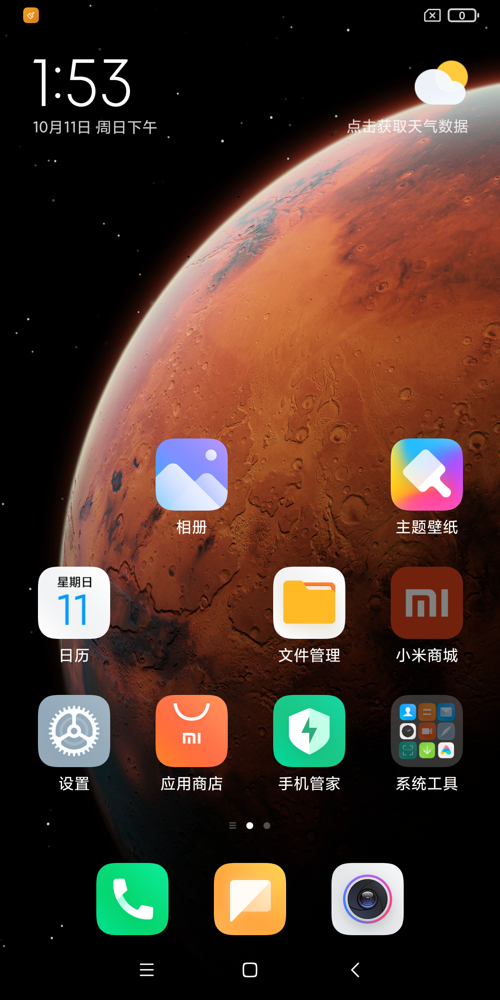
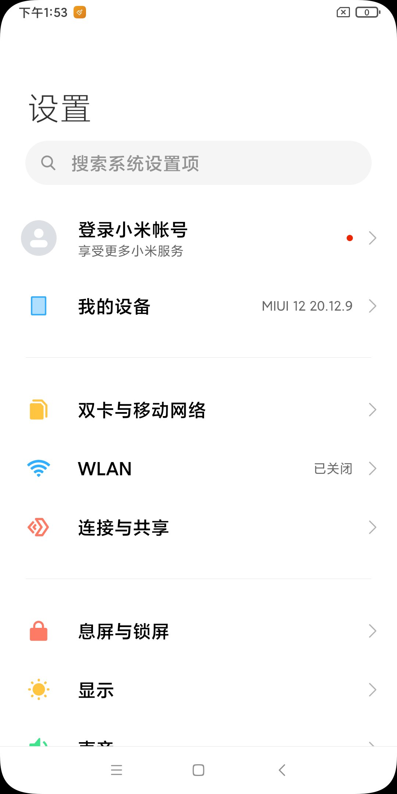

# MIUI 12 / Android 10 免 root 启动试验

2026-10-11，使用 Redmi K20 Pro（raphael）开发版 20.12.9 的完整 OTA。MIUI 用户空间已免 root 启动，完成用户解锁和首次配置，进入 `com.miui.home/.launcher.Launcher`。桌面壁纸、中文图标、时钟、底部应用栏均正常显示，点击设置及 HOME 返回通过验收。

本轮把显示改为 **1080×2160（18:9）**：宽度保留 1080，比原来的 1080×1920 增加 240 像素高度。GPU、客体显示模式、原生 Surface 和触摸映射使用配套尺寸；120 Hz 配置保留。MIUI 输入已接入独立 APK，应用名为 **A10VM MIUI12**，包名为 `io.a10vm.miui`；常规 Android 10 包名为 `io.a10vm`。MIUI 验收入口固定使用前者。





旧主体黑屏截图保留为 `evidence/miui12-boot-screen-before.png`。

## 全量备份

试验前备份目录：`/data/data/com.termux/files/home/android10-vm-backups/20261011-114928/`。

| 项目 | 结果 |
| --- | --- |
| 归档 | `android10-vm-full.tar` |
| 大小 | 27,410,503,680 字节，约 25.53 GiB |
| SHA-256 | `f544a41e4aa2971e106569a323553be2a5f84ac4870caf47522a26dec29de558` |
| 归档记录 | 92,529 条 |
| 内容 | 工程全目录，包含 Git、未提交修改、未跟踪与忽略文件、构建产物、镜像和缓存 |
| 保存方式 | GNU tar sparse/pax，保存权限、数字 UID/GID、ACL、扩展属性、SELinux 标签 |
| 回读比对 | `tar --compare` 退出码 0，`compare.log` 为空 |

9 个历史 Unix socket 节点由 tar 跳过；原路径记录在备份清单和 `create.log`，socket 由运行时重建。备份时通过 root 读取历史受限文件；下面的启动试验使用普通 Termux UID。

完整恢复说明和 `SHA256SUMS` 位于备份目录的 `README.md`。恢复时解包到新的空目录，保留当前工程作对照。

## ROM 与运行模型

原 ZIP：`/storage/emulated/0/Download/1DMP/Compressed/miui_RAPHAEL_20.12.9_8a0621754f_10.0.zip`。

| 工件 | 大小（字节） | SHA-256 |
| --- | ---: | --- |
| ZIP | 2,822,425,488 | `4107c1aad79be2bec98cd0646b1bc6682baba7f75660c721f818a263bacae633` |
| system.raw | 3,758,096,384 | `9875c88b66743014b4963a26cd7f63816f877f5f7d6b10e3ace83b10980a3c56` |
| vendor.raw | 1,610,612,736 | `a10516c398c3c78d914551c4d8ff37160722045af7fb0692fdd45a3a0fa22596` |
| boot.img | 134,217,728 | `ab45e98c66c11b67cc253903f52709b7f6af1e135604b997579845c29bc7bf6d` |

导入前后 ZIP 哈希一致，结果见 `artifacts/experiments/miui12-20.12.9/import.json`。该 ROM 为 Android 10 / SDK 29 / ARM64，安全补丁日期 2020-11-01。

本轮运行 MIUI 的 ART、framework、系统服务与应用，复用 A10VM 的加载器、Binder/HwBinder、宿主 GPU 和设备桥，共享宿主内核。`boot.img` 已保存。此次验证覆盖用户空间启动，内核启动和刷入分区属于其他阶段。

当前宿主为 Android 16 / PJZ110。独立 Termux 试验的服务和验收进程身份样本均为真实 UID `10373`、`CapEff=0000000000000000`；APK 的进程身份单独记录。客体系统 UID、组和能力位是容器内部映射。

## 可复现入口

APK 构建复用已验收的 ROM 输入，单独暂存到 `guest-runtime/build/rom-prepared/miui12`。原始 prepared 缓存保持原样：

```sh
sh tools/build-miui-apk.sh
env -u LD_LIBRARY_PATH -u LD_PRELOAD python3 tools/verify-native-display-apk.py \
    --runtime-prepared guest-runtime/build/rom-prepared/miui12
```

安装构建出的 MIUI APK 后，前台验收使用：

```sh
env -u LD_LIBRARY_PATH -u LD_PRELOAD python3 tools/test-apk-desktop.py \
    --package io.a10vm.miui --direct-start --timeout 120 --stability-seconds 5 \
    --output artifacts/experiments/miui12-20.12.9/apk-desktop-replay-01
```

开发自动化通过设备 root 安装、启动和读取日志；客体由应用服务启动，运行身份保持普通应用 UID、零有效能力、`untrusted_app`。验收同时断言客体 HOME 为 `com.miui.home`，并检查真实 APK Surface。首次安装需要解开完整 ROM 资源和扫描系统包，耗时与已有数据的再次启动分别统计。

独立 ROM 试验继续使用以下目录：

- 最终 ROM 输入：`artifacts/experiments/miui12-20.12.9/prepared-v2/`。
- Java 覆盖：`artifacts/experiments/miui12-20.12.9/bootstrap/dex/classes.dex`。
- 最新报告与截图：`artifacts/experiments/miui12-20.12.9/desktop-1080x2160/`。
- 原 1080×1920 交互通过现场：`artifacts/experiments/miui12-20.12.9/desktop-touch-identity/`。

每次运行输出目录必须是新的空路径。试验结束会停止本轮子进程，保留 JSON 报告并删除独立 runtime、进程日志和 PPM 截图，失败时也清理。需要继续检查运行目录时显式传入 `--keep-runtime`；需要保留原始日志和截图时单独传入 `--keep-diagnostics`：

```sh
cd /data/data/com.termux/files/home/android10-vm
MIUI_TRIAL=artifacts/experiments/miui12-20.12.9
env -u LD_LIBRARY_PATH -u LD_PRELOAD python3 tools/try-android-rom.py \
    "$MIUI_TRIAL/prepared-v2" "$MIUI_TRIAL/desktop-replay-01" \
    --phase desktop --seconds 60 --boot-jni qti_performance \
    --bootstrap "$MIUI_TRIAL/bootstrap/dex/classes.dex" \
    --tap-check 0.148,0.75,com.android.settings \
    --tap-check 0.5,0.97,com.miui.home
```

`--tap-check X,Y,PACKAGE` 的坐标相对于捕获帧归一化，范围为 `[0,1)`；坐标由这份 ROM 的默认桌面布局确定，布局变化时应按新截图调整。验收使用真实 `MotionEvent` 注入，再检查实际前台包和窗口绘制，分别保存设置和返回桌面的帧。报告包含 `bootCompleted`、`userUnlocked`、`homeWindowDrawn`、`desktopVerified` 和 `touch`；任一步失败都会让 `passed=false`，命令退出码为 1。

从 ZIP 全流程导入的入口为 `sh tools/try-android10-ota.sh ROM_ZIP NEW_OUTPUT_DIRECTORY`。前置条件是工程已有配套 `guest-runtime/build/prepared`、动态 libc/CRT 和 `artifacts/container/framework/classes`、Python 3.11+、Brotli、debugfs、JDK、Clang/LLD、Android SDK 35 / D8、NDK，以及含 dexlib2 的 JADX JAR。脚本复用项目已有的 `guest-runtime/build-tools/PatchWifiRelay.java`，并构建 ROM 服务身份桥。

## 本轮适配

导入、运行配置和启动验收分别放在 `import-android-ota.py`、`rom_runtime_profile.py`、`try-android-rom.py`。共用现有运行实例，新增可选 prepared 参数与 ROM APEX 别名，稳定输入仍使用原默认值。

- 读取 ROM 的 runtime APEX 与 classpath，导入完整 system/vendor 文件；保留来源及每个派生输入的哈希。
- 从原 init 脚本恢复 204 个数据目录，将 `/data/data` 映射至客体 `/data/user/0`。普通 UID 提取保留文件内容；原始物理 owner 的恢复另需权限。
- 使用短 runtime 路径，解决 Unix socket 地址长度限制。
- 配对 Binder/HIDL 桥和音频 HAL 的声明、实现、XML；seccomp 按系统调用名合并，避免重复 label。
- 引导时加载 ROM QPerformance JNI；保留客体 libselinux 桥；清空派生 FRP 属性。
- 增加 OEM netd Binder 返回值、必要监听注册和进程登记，记录客体 firewall UID chain 状态。
- 应用和服务以客体 rootfs 为工作目录，支持 MIUI 使用相对路径加载字体。
- 按宿主桥实际能力裁剪试验 runtime 的 VINTF 条目，避免 GNSS、传感器、振动服务等待。
- 提供 WiFi Messenger 的 AsyncChannel 连接与断开握手，恢复 MIUI SystemUI 创建。
- 等待用户解锁，再跟随 Provision 完成后默认 HOME 的切换；旧的 `sys.boot_completed=1` 单一条件会提前捕获画面。
- 启动 ROM 原有 `shelld`。其 `setgroups` 曾被宿主 seccomp 以 `SIGSYS` 终止；独立身份桥承接服务启动时的 UID、GID、附加组和能力位变更，实际宿主身份保持普通 UID、零能力。
- 复用公共属性合并器，按 Android 分区优先级补齐 `ro.product.device/model/brand/name`；绝对软链接在 ROM 根目录内解析，先校验原 ROM SDK/ABI，再应用运行覆盖。
- 在公共显示头文件设置 1080×2160，同步更新原生显示清单和尺寸验收；Surface 等比测量和触摸缩放继续共用原生尺寸。
- 使用同一 ROM 的 `libbinder.so` 与 `libsensorservice.so`，保留既有独立 Binder 传输。baseline Binder 缺少 MIUI 的 `IBatteryStats::noteStartSensorWithPkg/noteStopSensorWithPkg` 虚函数，APK 接通宿主传感器后曾在 `PowerManagerSer` 跳转至 `pc=0x20`。导入与桥接适配均保留 ROM Binder；缓存输入在 APK staging 时配对。
- 补齐宿主网络桥的 `tagSocketWithPid` 动态导出。MIUI `QTagUid_tagSocketFdWithPid` 曾因缺少该符号调用空指针。宿主导出带 PID 接口时直接转发；否则使用现有 `tagSocket`，保持 UID 映射及错误返回。后一条路径覆盖 socket 流量标记，MIUI 私有 PID 统计语义仍需单独实现。
- 补齐 Binder 安全上下文事务：DRM 注册的 `FLAT_BINDER_FLAG_TXN_SECURITY_CTX` 曾被传输桥拒绝，随后重试命令返回 `-22`，管理服务关闭整个客体。现在从真实调用 socket 读取 `SO_PEERSEC`，通过 `BR_TRANSACTION_SEC_CTX` 交付；上下文与 Parcel 共享只读缓冲区及释放时机，同步处理队列派发、线程扩容与退出回收。客体 UID 映射保留，SELinux 标签由宿主内核提供。

OEM 未实现的布尔能力返回 false，firewall 仅维护客体内存状态；WiFi channel 当前覆盖握手。真实内核规则、QoS、完整小米 WiFi 私有协议仍需后续独立实现。

曾尝试 baseline libhwui，发现其缺少 MIUI `libandroid_runtime` 所需的 `RenderProxy::setDisableWCGFlag(bool)`，已恢复 MIUI 原件并更新清单。

这种分工遵循 KISS/YAGNI：复用现有运行链路，只补当前启动与交互所需接口；DRY：复用属性合并、输入注入与前台窗口验收；SRP/SOLID：导入、适配、ROM 服务身份和触摸验收分开，避免扩大启动脚本的职责。

## 验证证据

| 层级 | 结果 |
| --- | --- |
| OTA 转换 | 4 个测试通过：稀疏范围、非法/增量输入、截断/尾部载荷、zero 覆盖 |
| 运行配置 | 5 个测试通过：init 目录映射、seccomp 去重、音频 HAL 配对、分区机型属性和 ROM 绝对软链接 |
| APK staging | 6 个测试通过，包含原 ROM Binder、当前网络桥及 Binder 传输桥更新，原缓存保持原样 |
| 网络动态 ABI | `tagSocketWithPid` 有/无宿主同名接口两条路径通过，UID 映射、参数和错误码保留 |
| Binder 安全上下文 | DRM SID 请求注册、真实 `SO_PEERSEC`、上下文缓冲生命周期及畸形输入检查通过 |
| Binder 传输回归 | 67 条传输断言、Chromium 40/128 FD 及内联/共享载荷检查、25 条独立进程原生 Binder 检查通过 |
| 公共属性合并 | 2 个现有测试通过；原 ROM SDK 30 仍被拒绝，运行覆盖保留 ARM64 |
| ROM 服务身份 | 原生检查通过；客体 UID 0→1000、附加组和能力位可读回，内核 UID 保持 10373、有效能力为 0 |
| 编译与静态检查 | Python 编译、Shell 语法、Java/D8 编译、Git 差异检查通过 |
| ART | 普通 UID 运行，`art_runtime_ready=1` |
| Java Binder | 64 次往返通过 |
| HwBinder | 原调用超时；配对 HIDL 后 `rom_hardware_ready=1` |
| 包管理 | 完成 245 个包的应用数据核对；输入包含 318 个 APK 路径，路径数与包数分别统计 |
| SystemServer | `Starting phase 1000` 和 `Starting phase 1000 done` |
| HOME | `rom_boot_completed=1`、`rom_user_unlocked=true`、`rom_home_package=com.miui.home`；桌面窗口 `mHasSurface=true`、`HAS_DRAWN` |
| 显示 | 桌面主体、壁纸、中文标签、时钟和底栏已显示；当前配置为 1080×2160 |
| 触摸 | 设置图标→`com.android.settings/.MiuiSettings`，HOME→`com.miui.home/.launcher.Launcher`；两次真实跳转均有绘制帧 |

旧黑屏帧只有 4,017 / 2,073,600 个非黑像素（0.193721%）。修复后的 1080×1920 帧有 1,491,882 个非黑像素（71.946470%）。当前 1080×2160 桌面帧有 1,533,484 / 2,332,800 个非黑像素（65.735768%），设置页有 2,304,965 个；完整触摸检查成功，4 个事件均被接受。最大输入确认耗时 16.17 ms，表示注入确认耗时，点击到完成页面绘制耗时需另行测量。

`report.json` 中的进程存活状态是清理前的采样；试验结束已停止本轮进程。音视频、相机、联网、第三方应用、多宿主版本和长期稳定性尚未验收；120 Hz 表示配置目标，本轮未作持续实际帧率测量。

结构化结果见 [miui12-boot-trial.json](evidence/miui12-boot-trial.json)。详细现场包括 `system-server.log`、`desktop-check.log`、`compositor.log`、`gpu.log`、`runtime-inputs.json` 和应用日志。

## 产物回收与下一步

MIUI APK 当前交付为 `0.2.52-miui12-ready-dispatch` / versionCode 62，已覆盖安装到 `io.a10vm.miui`，保留应用数据。APK 的 v2 签名、2628 个原生文件、5147 个运行资源和 319 个系统 APK 内容校验通过。应用服务入口启动 22.970 秒进入 MIUI HOME，5 秒稳定检查通过，UID/EUID 为 10326、CapEff 为零。分发与发送按状态变化调度，线程注册只查询所属 Binder context，已有 DEX 缓存继续复用。QQ/抖音重开 WaitTime 为 1.881/2.419 秒；MIUI 左右滑屏为 117.90 FPS，抖音仍为 72.84 FPS。新 CPU 采样显示节点回收占 36.42%，该性能项继续优化。v0.2.49 的 KEVA 和大纹理修复保留，QQ 原空间视频仍待回放。历史开发者设置、输入法与商店下载安装结果分别记录，版本、哈希和验证边界见 [MIUI APK 交付证据](evidence/miui12-apk-release.json) 与 [本轮性能记录](PERFORMANCE.md)。

删除本轮 26 个旧 runtime 和一个旧 prepared 副本，目录统计已分配字节共 137,707,810,304（约 128.25 GiB）。删除前保存诊断文件并核对复制哈希；原来的各轮报告、日志和截图均保留。完整列表见试验目录的 `cleanup.json`。

原 ZIP、备份、raw 镜像、extracted、prepared-v2、bootstrap、WiFi 派生 JAR，以及关键运行现场均保留。旧清理的文件系统观测空闲空间增加 139,120,840,704 字节；该观测也受同期宿主文件活动影响。

本轮另清理两份确定失败的 runtime 副本，回收已分配空间 10,958,415,360 字节（约 10.21 GiB）；删除前保存并核对 236 份诊断文件哈希。完整列表见 `cleanup-desktop.json`。旧图形二进制另存于 `graphics-1080x1920/`，可回滚尺寸变更。

下一步逐项验证 APK 内的 MIUI 系统应用、WebView、音视频及第三方软件，再覆盖其他宿主 Android 版本。

工具调用均为本地 Shell、Java/JADX、图像读取及 Git/GitHub CLI；本轮 MCP 服务调用为 0。
